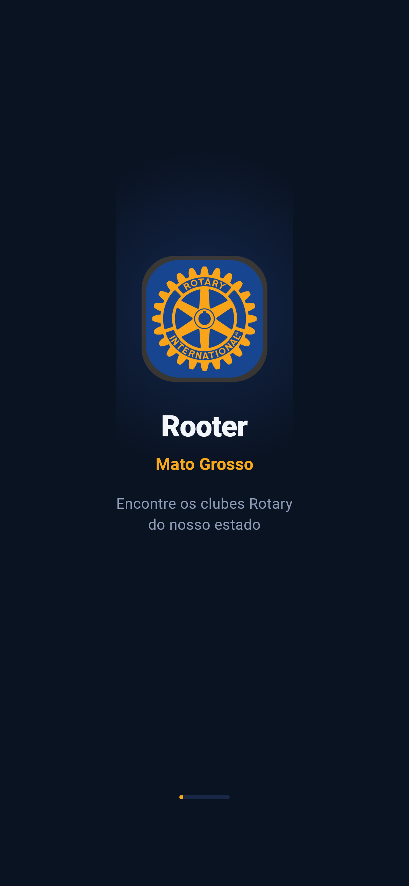
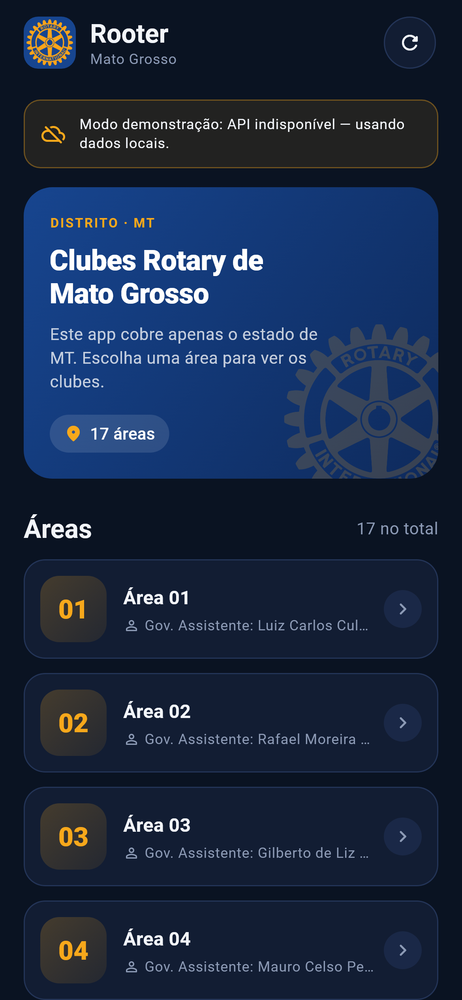
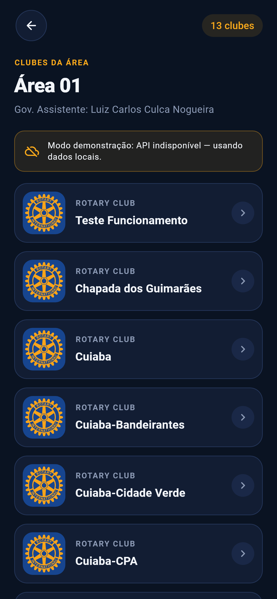
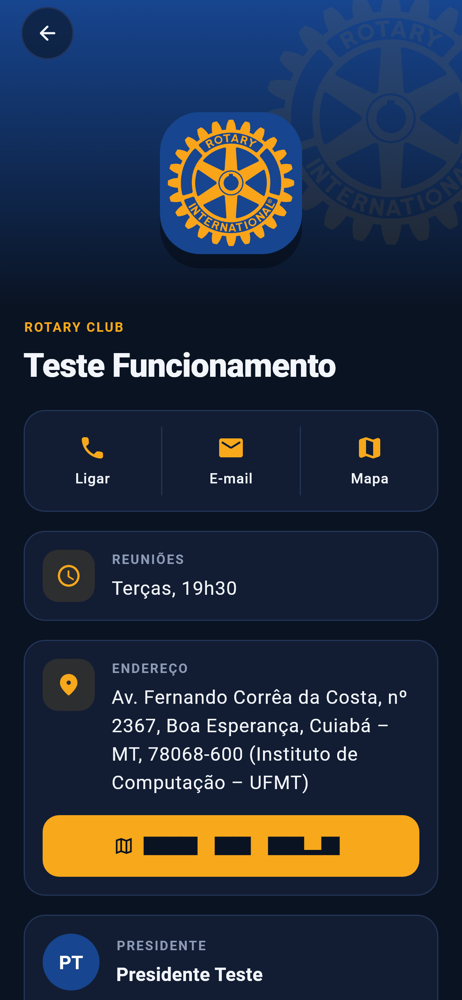

# Rooter — Documentação Técnica e Funcional do Sistema

**Aplicativo de localização de Clubes Rotary do Estado de Mato Grosso**

| Item | Valor |
|------|-------|
| Produto | Rooter MT (Rotary Club — Mato Grosso) |
| Versão do app | 1.0.0 (build 1) |
| Versão da API | 0.1.0 |
| Escopo geográfico | Somente o estado de Mato Grosso (MT) |
| Stack | Flutter (app) · FastAPI/Python (API) · Shorebird (atualizações OTA) |
| Data deste documento | 11/10/2026 |

---

## Sumário

1. [Visão geral](#1-visão-geral)
2. [Arquitetura](#2-arquitetura)
3. [Estrutura do repositório](#3-estrutura-do-repositório)
4. [Backend (API FastAPI)](#4-backend-api-fastapi)
5. [Base de dados (`clubs.json`)](#5-base-de-dados-clubsjson)
6. [Aplicativo mobile (Flutter)](#6-aplicativo-mobile-flutter)
7. [Atualizações OTA com Shorebird](#7-atualizações-ota-com-shorebird)
8. [Instalação e execução](#8-instalação-e-execução)
9. [Testes](#9-testes)
10. [Build e distribuição](#10-build-e-distribuição)
11. [Guia de manutenção](#11-guia-de-manutenção)
12. [Segurança, privacidade e LGPD](#12-segurança-privacidade-e-lgpd)
13. [Limitações conhecidas e pontos de atenção](#13-limitações-conhecidas-e-pontos-de-atenção)
14. [Roadmap sugerido](#14-roadmap-sugerido)
15. [Solução de problemas](#15-solução-de-problemas)
16. [Glossário](#16-glossário)
17. [Apêndices](#17-apêndices)

---

## 1. Visão geral

### 1.1 Propósito

O **Rooter** é um aplicativo facilitador para que qualquer pessoa — rotariano, visitante, convidado ou membro da comunidade — encontre rapidamente um **Clube Rotary no estado de Mato Grosso** e entre em contato com ele. O usuário:

1. Escolhe uma **Área** do distrito (Área 01 a Área 17);
2. Vê a lista de **clubes** daquela área;
3. Abre o **detalhe do clube**, onde encontra:
   - horário de **reunião** (quando disponível);
   - **endereço**, com um toque para abrir no **Google Maps**;
   - **presidente** do clube, com **telefone** (toque para ligar) e **e-mail** (toque para enviar mensagem).

<p align="center">
  
  
  
  
</p>
<p align="center"><em>Abertura · Áreas · Clubes da área · Detalhe do clube (modo demonstração)</em></p>

### 1.2 Escopo do MVP

| Incluído no MVP | Fora do MVP |
|-----------------|-------------|
| Navegação Áreas → Clubes → Detalhe | Login / autenticação |
| Contato do presidente (ligar / e-mail) | Painel administrativo (CRUD) |
| Endereço com abertura no Google Maps | Mapa embutido no app |
| Horário de reunião (quando cadastrado) | GPS / "clubes perto de mim" |
| Modo demonstração offline (dados embutidos) | Múltiplos distritos / estados |
| Atualização OTA via Shorebird | Banco de dados real |

### 1.3 Números da base atual

| Indicador | Quantidade |
|-----------|-----------:|
| Áreas | 17 |
| Clubes | 98 (97 reais + 1 clube de teste) |
| Clubes com endereço e coordenadas | 90 |
| Clubes com nome do presidente | 83 |
| Clubes com telefone do presidente | 77 |
| Clubes com e-mail do presidente | 77 |
| Clubes com horário de reunião | 1 (apenas o clube de teste) |

---

## 2. Arquitetura

### 2.1 Diagrama de componentes

```
┌──────────────────────────────────────────────────────────────────┐
│                     APP FLUTTER (Rooter MT)                      │
│                                                                  │
│  ┌─────────────┐   ┌─────────────┐   ┌────────────────────────┐  │
│  │  AreasPage  │──▶│  ClubsPage  │──▶│     ClubDetailPage     │  │
│  └──────┬──────┘   └──────┬──────┘   └───────────┬────────────┘  │
│         │                 │                      │               │
│         └────────────┬────┴──────────────────────┘               │
│                      ▼                                           │
│              ┌───────────────┐   falha / timeout 3s              │
│              │  ApiService   │──────────────────────┐            │
│              └───────┬───────┘                      ▼            │
│                      │ HTTP GET           ┌──────────────────┐   │
│                      │                    │   LocalCatalog   │   │
│                      │                    │ assets/data/     │   │
│                      │                    │   clubs.json     │   │
│                      │                    └──────────────────┘   │
│ url_launcher ──▶ Google Maps · Discador (tel:) · E-mail (mailto:)│
└──────────────────────┼───────────────────────────────────────────┘
                       │
                       ▼
┌──────────────────────────────────────────────────────────────────┐
│                  API FastAPI (Rooter Rotary API)                 │
│                                                                  │
│   main.py (rotas) ──▶ data_loader.py (lru_cache) ──▶ clubs.json  │
│   models.py (Pydantic: Area, ClubSummary, ClubDetail)            │
└──────────────────────────────────────────────────────────────────┘

┌──────────────────────────────────────────────────────────────────┐
│  Shorebird (nuvem): distribui patches OTA do código Dart do app  │
└──────────────────────────────────────────────────────────────────┘
```

### 2.2 Stack tecnológica

| Camada | Tecnologia | Versão |
|--------|-----------|--------|
| App | Flutter (canal stable) | 3.44.x (requer `>=3.44.0`) |
| Linguagem do app | Dart | SDK `^3.12.2` |
| HTTP no app | `http` | 1.6.0 |
| Links externos | `url_launcher` | 6.3.2 |
| Ícones iOS | `cupertino_icons` | 1.0.9 |
| Lints | `flutter_lints` | 6.0.0 |
| API | FastAPI | 0.115.6 |
| Servidor ASGI | Uvicorn (`[standard]`) | 0.34.0 |
| Validação/serialização | Pydantic | 2.10.4 |
| Linguagem da API | Python | 3.10+ (usa sintaxe `str \| None`) |
| OTA | Shorebird | app_id `2538bba3-a691-4a89-9f42-afa924fcaece` |
| Android build | Gradle 9.1.0 · AGP 9.0.1 · Kotlin 2.3.20 · Java 17 | — |
| iOS | Deployment target 13.0 | — |

### 2.3 Princípios de projeto

- **Simplicidade:** a API é somente leitura e lê um único arquivo JSON; não há banco de dados.
- **Resiliência para demonstração:** o app nunca fica "vazio" — se a API não responde, ele usa uma cópia embutida dos dados e avisa o usuário.
- **Delegação ao sistema operacional:** mapas, ligações e e-mails são abertos nos apps nativos do aparelho (Google Maps, discador, cliente de e-mail), evitando dependências pesadas.
- **Atualização sem loja:** correções de código Dart podem ser enviadas via Shorebird sem republicar na Play Store / App Store.

---

## 3. Estrutura do repositório

```
Rooter/
├── README.md                      # Guia rápido do projeto
├── .gitignore
├── docs/
│   ├── DOCUMENTACAO_ROOTER.md     # Este documento
│   ├── DOCUMENTACAO_ROOTER.pdf    # Versão PDF deste documento
│   ├── img/                       # Capturas de tela do app
│   └── tools/                     # gerar-pdf.mjs + package.json (gera o PDF)
├── backend/
│   ├── README.md
│   ├── requirements.txt           # fastapi, uvicorn[standard], pydantic
│   ├── data/
│   │   └── clubs.json             # Fonte de dados (áreas + clubes)
│   └── app/
│       ├── __init__.py
│       ├── main.py                # Instância FastAPI, CORS e rotas
│       ├── models.py              # Modelos Pydantic de resposta
│       └── data_loader.py         # Leitura do JSON com cache em memória
└── mobile/
    ├── pubspec.yaml               # Dependências e assets do app
    ├── pubspec.lock
    ├── shorebird.yaml             # Configuração do Shorebird (app_id)
    ├── analysis_options.yaml      # Regras de lint (flutter_lints)
    ├── assets/data/clubs.json     # Cópia embutida dos dados (modo offline)
    ├── assets/images/rotary_logo.png # Logo Rotary usada na interface
    ├── lib/
    │   ├── main.dart              # Ponto de entrada (RooterApp)
    │   ├── config/api_config.dart # URL base da API (--dart-define)
    │   ├── models/models.dart     # Area, ClubSummary, ClubDetail
    │   ├── services/
    │   │   ├── api_service.dart   # Cliente HTTP + fallback offline
    │   │   └── local_catalog.dart # Leitura do JSON embutido
    │   ├── screens/
    │   │   ├── areas_page.dart    # Tela 1: lista de áreas
    │   │   ├── clubs_page.dart    # Tela 2: clubes da área
    │   │   └── club_detail_page.dart # Tela 3: detalhe do clube
    │   ├── theme/rotary_theme.dart   # Tema escuro Material 3 (cores Rotary)
    │   └── widgets/rotary_widgets.dart # Componentes visuais reutilizáveis
    ├── test/widget_test.dart      # Teste de widget (fallback local)
    ├── android/ ios/ web/ windows/ macos/ linux/   # Projetos nativos
```

---

## 4. Backend (API FastAPI)

### 4.1 Visão geral

A API **Rooter Rotary API — Mato Grosso** (versão `0.1.0`) é um serviço HTTP **somente leitura** que expõe áreas e clubes a partir do arquivo `backend/data/clubs.json`. A documentação interativa (Swagger UI) é gerada automaticamente pelo FastAPI em `/docs` e o esquema OpenAPI em `/openapi.json` (também há ReDoc em `/redoc`).

### 4.2 Módulos

| Arquivo | Responsabilidade |
|---------|------------------|
| `app/main.py` | Cria a aplicação FastAPI, configura CORS e define as 4 rotas. |
| `app/models.py` | Define os modelos Pydantic `Area`, `ClubSummary` e `ClubDetail`, usados como `response_model`. |
| `app/data_loader.py` | Função `load_data()` que lê `data/clubs.json` (UTF-8) e guarda o resultado em cache com `@lru_cache(maxsize=1)`. |
| `app/__init__.py` | Marca o diretório como pacote Python. |

### 4.3 Carregamento de dados e cache

- O caminho do arquivo é calculado a partir do próprio módulo: `backend/data/clubs.json`.
- `load_data()` é decorada com `functools.lru_cache(maxsize=1)`: o arquivo é lido **uma única vez** por processo, na primeira requisição.
- **Consequência importante:** alterações em `clubs.json` só passam a valer após **reiniciar** o servidor. (Com `uvicorn --reload`, o reinício automático só ocorre quando arquivos `.py` mudam, não o JSON.)

### 4.4 CORS

O middleware CORS está totalmente aberto:

```python
allow_origins=["*"], allow_credentials=True, allow_methods=["*"], allow_headers=["*"]
```

Isso permite que o app (inclusive a versão web do Flutter) consuma a API de qualquer origem. Veja recomendações para produção na [seção 12](#12-segurança-privacidade-e-lgpd).

### 4.5 Endpoints

| Método | Rota | Descrição | Resposta | Erros |
|--------|------|-----------|----------|-------|
| GET | `/health` | Verificação de saúde | `{"status": "ok"}` | — |
| GET | `/areas` | Lista todas as áreas | `Area[]` | — |
| GET | `/areas/{area_id}/clubs` | Lista os clubes de uma área | `ClubSummary[]` | 404 `Área não encontrada` |
| GET | `/clubs/{club_id}` | Detalhe de um clube | `ClubDetail` | 404 `Clube não encontrado` |

#### `GET /health`

```http
GET /health HTTP/1.1
```

```json
{ "status": "ok" }
```

#### `GET /areas`

Retorna as áreas na ordem em que aparecem no JSON (Área 01 → Área 17).

```json
[
  {
    "id": "area-01",
    "name": "Área 01",
    "number": 1,
    "assistant_governor": "LUIZ CARLOS CULCA NOGUEIRA"
  },
  {
    "id": "area-13",
    "name": "Área 13",
    "number": 13,
    "assistant_governor": null
  }
]
```

#### `GET /areas/{area_id}/clubs`

Retorna somente os campos resumidos de cada clube. Se a área existir mas não tiver clubes (caso da Área 13), retorna lista vazia `[]`.

```http
GET /areas/area-01/clubs HTTP/1.1
```

```json
[
  { "id": "area-01-teste-funcionamento", "area_id": "area-01", "name": "Teste Funcionamento" },
  { "id": "area-01-chapada-dos-guimaraes", "area_id": "area-01", "name": "Chapada dos Guimarães" },
  { "id": "area-01-cuiaba", "area_id": "area-01", "name": "Cuiaba" }
]
```

Área inexistente:

```http
HTTP/1.1 404 Not Found
{ "detail": "Área não encontrada" }
```

#### `GET /clubs/{club_id}`

```http
GET /clubs/area-01-teste-funcionamento HTTP/1.1
```

```json
{
  "id": "area-01-teste-funcionamento",
  "area_id": "area-01",
  "name": "Teste Funcionamento",
  "president_name": "Presidente Teste",
  "president_phone": "65 99999-0000",
  "president_email": "teste@rotary.local",
  "address": "Av. Fernando Corrêa da Costa, nº 2367, Boa Esperança, Cuiabá – MT, 78068-600 (Instituto de Computação – UFMT)",
  "latitude": -15.6088,
  "longitude": -56.0645,
  "meeting_schedule": "Terças, 19h30"
}
```

Clube inexistente:

```http
HTTP/1.1 404 Not Found
{ "detail": "Clube não encontrado" }
```

### 4.6 Modelos de resposta (Pydantic)

**`Area`**

| Campo | Tipo | Obrigatório | Descrição |
|-------|------|:-----------:|-----------|
| `id` | `str` | Sim | Identificador (`area-01` … `area-17`) |
| `name` | `str` | Sim | Nome exibido (`Área 01`) |
| `number` | `int` | Sim | Número da área |
| `assistant_governor` | `str \| None` | Não | Governador(a) Assistente da área |

**`ClubSummary`**

| Campo | Tipo | Obrigatório | Descrição |
|-------|------|:-----------:|-----------|
| `id` | `str` | Sim | Identificador do clube |
| `area_id` | `str` | Sim | Área à qual pertence |
| `name` | `str` | Sim | Nome do clube |

**`ClubDetail`**

| Campo | Tipo | Obrigatório | Descrição |
|-------|------|:-----------:|-----------|
| `id` | `str` | Sim | Identificador do clube |
| `area_id` | `str` | Sim | Área à qual pertence |
| `name` | `str` | Sim | Nome do clube |
| `president_name` | `str \| None` | Não | Nome do presidente |
| `president_phone` | `str \| None` | Não | Telefone do presidente (texto livre) |
| `president_email` | `str \| None` | Não | E-mail do presidente |
| `address` | `str \| None` | Não | Endereço completo em texto |
| `latitude` | `float \| None` | Não | Latitude (WGS84) |
| `longitude` | `float \| None` | Não | Longitude (WGS84) |
| `meeting_schedule` | `str \| None` | Não | Dia/horário de reunião em texto livre |

### 4.7 Complexidade e desempenho

Todas as consultas fazem varredura linear em memória sobre ~100 registros — custo desprezível. O primeiro acesso paga a leitura do arquivo; os seguintes usam o cache.

---

## 5. Base de dados (`clubs.json`)

### 5.1 Localização e sincronização

Existem **duas cópias idênticas** do arquivo:

| Cópia | Uso |
|-------|-----|
| `backend/data/clubs.json` | Fonte de dados da API |
| `mobile/assets/data/clubs.json` | Dados embutidos no app para o modo offline/demonstração |

No momento da elaboração deste documento as duas cópias têm **conteúdo idêntico**. Qualquer alteração deve ser replicada nas duas (veja a [seção 11](#11-guia-de-manutenção)).

### 5.2 Estrutura do arquivo

```json
{
  "district": "Rotary Club — Mato Grosso",
  "state": "MT",
  "scope": "Somente clubes do estado de Mato Grosso",
  "areas": [ { "id": "...", "name": "...", "number": 1, "assistant_governor": "..." } ],
  "clubs": [ { "id": "...", "area_id": "...", "name": "...", "president_name": "...",
               "president_phone": "...", "president_email": "...", "address": "...",
               "latitude": -15.6, "longitude": -56.0, "meeting_schedule": null } ]
}
```

Os campos `district`, `state` e `scope` são metadados informativos — **não são expostos pela API** nem lidos pelo app.

### 5.3 Convenção de identificadores

- **Área:** `area-NN`, com dois dígitos (`area-01` … `area-17`).
- **Clube:** `area-NN-<slug-do-nome>`, em minúsculas, sem acentos, com hífens. Ex.: `area-01-cuiaba-bandeirantes`.
- Todos os 98 `id` de clubes são **únicos** (verificado).

### 5.4 Origem dos dados

Os dados foram montados a partir da **lista de presidentes atualizada** do distrito e de uma **lista de endereços** de portal, complementados pelo clube fictício **"Teste Funcionamento"** (Área 01), que usa o endereço do **Instituto de Computação da UFMT** (Cuiabá) e é o único com horário de reunião preenchido. Ele serve para validar todas as funções da tela de detalhe em demonstrações.

### 5.5 Abrangência geográfica

As coordenadas cadastradas cobrem todo o território mato-grossense:

| Eixo | Mínimo | Máximo |
|------|-------:|-------:|
| Latitude | -17,208 | -9,445 |
| Longitude | -59,335 | -52,159 |

### 5.6 Estatísticas por área

| Área | Governador(a) Assistente | Clubes | Endereço | Presidente | Telefone | E-mail |
|------|--------------------------|------:|------:|------:|------:|------:|
| 01 | Luiz Carlos Culca Nogueira | 13 | 12 | 13 | 13 | 13 |
| 02 | Rafael Moreira Libano | 8 | 6 | 8 | 7 | 7 |
| 03 | Gilberto de Liz Camargo | 6 | 6 | 6 | 5 | 5 |
| 04 | Mauro Celso Pereira Ribeiro | 8 | 7 | 7 | 5 | 6 |
| 05 | João Guerino Faneli | 8 | 7 | 7 | 7 | 7 |
| 06 | Aparecida Maria Vieira | 7 | 7 | 7 | 7 | 7 |
| 07 | Altair Barbosa | 5 | 4 | 4 | 4 | 4 |
| 08 | Denilson Togni | 5 | 5 | 3 | 3 | 3 |
| 09 | Eduardo da Rocha Sperotto | 5 | 5 | 5 | 5 | 5 |
| 10 | Edson Pereira | 6 | 6 | 5 | 5 | 5 |
| 11 | Oelson Copetti | 7 | 6 | 3 | 2 | 3 |
| 12 | Nilvo P. Lanza | 3 | 3 | 3 | 3 | 2 |
| 13 | *(não informado)* | 0 | 0 | 0 | 0 | 0 |
| 14 | Gilvano Souza de Oliveira | 5 | 4 | 3 | 2 | 3 |
| 15 | Marcelo dos Santos Inacio | 3 | 3 | 3 | 3 | 2 |
| 16 | Wender da Silva Mendonça | 3 | 3 | 3 | 3 | 3 |
| 17 | Domingus Sávio Santana | 6 | 6 | 3 | 3 | 2 |
| **Total** | | **98** | **90** | **83** | **77** | **77** |

> Os nomes dos Governadores Assistentes estão normalizados acima para leitura; no JSON alguns estão em CAIXA ALTA e com espaços duplos.

### 5.7 Clubes por área

Clubes marcados com **(s/ end.)** não possuem endereço/coordenadas cadastrados — no app, a seção "Endereço" não aparece para eles.

| Área | Clubes |
|------|--------|
| 01 | Teste Funcionamento (fictício); Chapada dos Guimarães; Cuiabá; Cuiabá-Bandeirantes; Cuiabá-Cidade Verde (s/ end.); Cuiabá-CPA; Cuiabá-Oeste; Cuiabá-Taiamã; Várzea Grande; Várzea Grande-Aeroporto; Várzea Grande-Centro; Várzea Grande-Cristo Rei; Várzea Grande-Portal do Norte |
| 02 | Rondonópolis; Rondonópolis-Comunidade; Rondonópolis-Cerrado; Rondonópolis-Dist. Vila Operária; Rondonópolis-Leste; Rondonópolis-Rio Vermelho (s/ end.); Rondonópolis-Rondon; Rondonópolis-Rosa Bororo (s/ end.) |
| 03 | Barra do Garças; Barra do Garças-Águas Quentes; Água Boa; Canarana; Querência; São José do Xingu |
| 04 | Cáceres; Cáceres Caramujo; Cáceres Flor do Pantanal; Cáceres-Pantanal; Porto Esperidião; Porto Esperidião-Vila Cardoso; Pontes e Lacerda - Centro; Vila Bela SS. Trindade-Centro (s/ end.) |
| 05 | Curvelândia; Figueirópolis D'Oeste-Centro; Lambari D'Oeste; Rio Branco-Rota das Águas; Mirassol D'Oeste; São José dos Quatro Marcos; Araputanga (s/ end.); Glória D'Oeste |
| 06 | Barra do Bugres; Denise; Nova Olímpia; Tangará da Serra; Tangará da Serra-Águas do Sepotuba; Tangará da Serra-Centro; Tangará da Serra-Cidade Alta |
| 07 | Alta Floresta; Alta Floresta-Centro; Paranaíta; Colíder; Nova Santa Helena (s/ end.) |
| 08 | Guarantã do Norte; Matupá; Nova Guarita; Peixoto de Azevedo; Terra Nova do Norte |
| 09 | Nova Ubiratã; Sorriso; Sorriso-Joia do Cerrado; Sorriso-Ouro Verde; Ipiranga do Norte |
| 10 | Cláudia; Sinop; Sinop-Tarumã; Sinop Teles Pires; Marcelândia; Vera |
| 11 | Lucas do Rio Verde; Itanhangá; Nova Maringá-Ponte da Pedra; Nova Mutum; Santa Rita do Trivelato; São José do Rio Claro (s/ end.); Tapurah |
| 12 | Arenápolis; Diamantino; Nobres |
| 13 | *(nenhum clube cadastrado)* |
| 14 | Campo Novo do Parecis; Campos de Júlio; Sapezal; Brasnorte-Centro; Comodoro (s/ end.) |
| 15 | Colniza; Juína; Juruena-Integração |
| 16 | Guiratinga; Itiquira; Pedra Preta |
| 17 | Campo Verde; Jaciara-Águas Cristalinas; Primavera do Leste; Poxoréu-Morro da Mesa; Santo Antônio do Leste; Juscimeira-Águas Termais |

> A grafia acima foi normalizada para leitura. No JSON, vários nomes estão sem acento ou com erros de digitação — veja a [seção 13.3](#133-qualidade-dos-dados).

---

## 6. Aplicativo mobile (Flutter)

### 6.1 Identificação do app

| Plataforma | Nome exibido | Identificador |
|------------|--------------|---------------|
| Android | Rooter MT | `br.org.rotary.rooter_mobile` |
| iOS | Rooter MT | `br.org.rotary.rooterMobile` |
| Título interno (MaterialApp) | Rooter — Mato Grosso | — |
| Pacote Dart | `rooter_mobile` | — |

Plataformas com projeto gerado: Android, iOS, Web, Windows, macOS e Linux. O foco do produto é **Android e iOS**.

### 6.2 Camadas do app

| Camada | Arquivos | Papel |
|--------|----------|-------|
| Entrada | `main.dart` | Inicializa o Flutter e cria `RooterApp` com tema escuro, estilo da barra de status e tela inicial |
| Configuração | `config/api_config.dart` | Define a URL base da API |
| Modelos | `models/models.dart` | Classes imutáveis com `fromJson` |
| Serviços | `services/api_service.dart`, `services/local_catalog.dart` | Acesso a dados online e offline |
| Telas | `screens/*.dart` | Interface e navegação |
| Componentes | `widgets/rotary_widgets.dart` | Cards, logo, banners, estados de carregamento/erro e utilitários de texto |
| Tema | `theme/rotary_theme.dart` | Identidade visual Rotary (tema escuro) |

O gerenciamento de estado é intencionalmente simples: `StatefulWidget` + `FutureBuilder` por tela, e um `ValueNotifier<bool>` para o indicador de modo offline. As telas usam `CustomScrollView` com *slivers* e "puxar para atualizar" (`RefreshIndicator`) nas listas. Uma **única instância** de `ApiService` é criada em `RooterApp.build` e repassada às telas por construtor (injeção manual de dependência).

### 6.3 Configuração da URL da API

A URL é definida em tempo de compilação via `--dart-define=API_BASE_URL=...`:

```dart
static const String baseUrl = String.fromEnvironment(
  'API_BASE_URL',
  defaultValue: 'http://10.0.2.2:8000',
);
```

| Ambiente | URL base |
|----------|----------|
| Emulador Android (padrão) | `http://10.0.2.2:8000` |
| iOS Simulator / desktop | `http://127.0.0.1:8000` |
| Dispositivo físico na mesma rede | `http://<IP-da-máquina>:8000` |
| Produção (futuro) | `https://<domínio-da-api>` |

### 6.4 Modelos (Dart)

Espelham os modelos da API, convertendo `snake_case` → `camelCase`:

| JSON | Dart | Tipo |
|------|------|------|
| `id` | `id` | `String` |
| `area_id` | `areaId` | `String` |
| `name` | `name` | `String` |
| `number` | `number` | `int` |
| `assistant_governor` | `assistantGovernor` | `String?` |
| `president_name` | `presidentName` | `String?` |
| `president_phone` | `presidentPhone` | `String?` |
| `president_email` | `presidentEmail` | `String?` |
| `address` | `address` | `String?` |
| `latitude` / `longitude` | `latitude` / `longitude` | `double?` (aceita `int` ou `double` no JSON) |
| `meeting_schedule` | `meetingSchedule` | `String?` |

Propriedades derivadas de `ClubDetail`:

- `hasLocation` → `true` se houver endereço não vazio **ou** latitude e longitude.
- `hasMeeting` → `true` se `meetingSchedule` não for nulo nem vazio.

### 6.5 `ApiService` — cliente HTTP com fallback offline

Métodos públicos:

| Método | Endpoint online | Fallback offline |
|--------|-----------------|------------------|
| `fetchAreas()` | `GET /areas` | `LocalCatalog.areas()` |
| `fetchClubsByArea(areaId)` | `GET /areas/{areaId}/clubs` | `LocalCatalog.clubsByArea(areaId)` |
| `fetchClub(clubId)` | `GET /clubs/{clubId}` | `LocalCatalog.clubById(clubId)` |

Funcionamento de `_withFallback`:

```
             ┌───────────────────────────┐
  chamada ──▶│ tenta online (GET + 3s)   │
             └────────────┬──────────────┘
                 sucesso? │
          ┌───── sim ─────┴───── não (qualquer exceção) ─────┐
          ▼                                                   ▼
 usingOfflineData = false                       lê assets/data/clubs.json
 retorna dados da API                           usingOfflineData = true
                                                retorna dados locais
```

Detalhes:

- **Timeout de 3 segundos** por requisição (`.timeout(Duration(seconds: 3))`).
- Respostas com status fora de 2xx geram `ApiException("Erro <status> ao acessar <path>")`, que também aciona o fallback.
- O corpo é decodificado como **UTF-8** a partir dos bytes (`utf8.decode(response.bodyBytes)`), garantindo acentuação correta.
- O fallback é avaliado **a cada chamada**: se a API voltar, a próxima tela já usa dados online.
- `usingOfflineData` é um `ValueNotifier<bool>` que a tela de Áreas observa para exibir o banner de modo demonstração.
- O construtor aceita `http.Client` e `baseUrl` opcionais, facilitando testes com *mocks*.

### 6.6 `LocalCatalog` — dados embutidos

- Lê `assets/data/clubs.json` via `rootBundle.loadString` (asset declarado no `pubspec.yaml`).
- Mantém o JSON decodificado em cache estático (`_raw`) após a primeira leitura.
- Implementa as mesmas consultas da API (todas as áreas; clubes por área; clube por id).
- Se o clube não existir, lança `StateError('Clube <id> não encontrado nos dados locais')`.

### 6.7 Telas e fluxo de navegação

```
┌───────────────┐  toque na área  ┌───────────────┐  toque no clube  ┌──────────────────┐
│   AreasPage   │ ───────────────▶│   ClubsPage   │ ────────────────▶│  ClubDetailPage  │
│ (tela inicial)│ ◀── voltar ──── │ (área X)      │ ◀── voltar ───── │ (clube Y)        │
└───────────────┘                 └───────────────┘                  └──────────────────┘
                                                                        │   │   │
                                                         Google Maps ◀──┘   │   └──▶ E-mail (mailto:)
                                                                     Discador (tel:)
```

A navegação usa `Navigator.push` com `MaterialPageRoute` (pilha simples). As telas não usam a AppBar padrão: o botão **Voltar** é um botão circular próprio (`CircleIconButton`), e o gesto/botão voltar do sistema também funciona.

#### Tela de abertura (carregamento inicial)

<p align="center"></p>

Enquanto a primeira lista de áreas é carregada (até ~3 s se a API estiver fora do ar), a `AreasPage` exibe uma tela de marca (`_BrandedLoading`): fundo com gradiente radial azul-escuro, **logo Rotary** com brilho dourado, "Rooter", "Mato Grosso" (em dourado), a frase "Encontre os clubes Rotary do nosso estado" e uma pequena barra de progresso dourada. A transição para o conteúdo é animada (`AnimatedSwitcher`, 350 ms).

#### Tela 1 — `AreasPage` (Áreas)

<p align="center"></p>

- **Cabeçalho:** logo Rotary, "Rooter" / "Mato Grosso" e botão circular **Atualizar** (vira um indicador de progresso enquanto recarrega).
- **Banner de modo demonstração** (`OfflineBanner`): faixa dourada com ícone de nuvem cortada e o texto *"Modo demonstração: API indisponível — usando dados locais."* Aparece/desaparece com animação.
- **Cartão de destaque** (`_HeroCard`): gradiente azul Rotary com a roda Rotary como marca d'água, rótulo "DISTRITO · MT", título "Clubes Rotary de Mato Grosso", o aviso "Este app cobre apenas o estado de MT. Escolha uma área para ver os clubes." e um selo com o total de áreas ("17 áreas").
- **Seção "Áreas"** com contador ("17 no total").
- **Cartões de área** (`_AreaCard`): número com dois dígitos em dourado ("01"), nome ("Área 01") e "Gov. Assistente: *nome*" — nomes em CAIXA ALTA são convertidos para "Nome Próprio" por `displayName()`.
- **Puxar para atualizar** recarrega as áreas.
- **Estados:** carregando (tela de abertura), erro ("Não foi possível carregar as áreas" + botão "Tentar de novo"), vazio ("Nenhuma área encontrada.").

#### Tela 2 — `ClubsPage` (Clubes da área)

<p align="center"></p>

- **Topo:** botão circular **Voltar** e um selo dourado com a quantidade ("13 clubes" / "1 clube").
- **Título:** rótulo "CLUBES DA ÁREA", nome da área em destaque e "Gov. Assistente: *nome*".
- **Banner de modo demonstração** (mesmo componente da tela de Áreas).
- **Cartões de clube** (`_ClubCard`): logo Rotary, rótulo "ROTARY CLUB" e nome do clube (até 2 linhas).
- **Puxar para atualizar** recarrega a lista.
- **Estados:** carregando (indicador central), erro ("Não foi possível carregar os clubes" + "Tentar de novo"), vazio ("Nenhum clube nesta área." — ocorre na Área 13).

#### Tela 3 — `ClubDetailPage` (Detalhe do clube)

<p align="center"></p>

- **Cabeçalho expansível** (`_HeroAppBar`, `SliverAppBar` com 260 px): gradiente azul, roda Rotary em marca d'água e logo grande. Ao rolar, o cabeçalho recolhe e o nome do clube aparece centralizado na barra fixa.
- **Título:** "ROTARY CLUB" + nome do clube.
- **Ações rápidas** (`_QuickAction`): três botões — **Ligar**, **E-mail** e **Mapa**. Cada um fica esmaecido e desativado quando o dado correspondente não existe. O cartão inteiro só aparece se houver ao menos uma ação disponível.

Cartões exibidos **somente quando há dados**:

| Cartão | Condição | Conteúdo | Ação |
|--------|----------|----------|------|
| Reuniões | `hasMeeting` | Ícone de relógio + horário | — |
| Endereço | `hasLocation` | Endereço (ou "Localização disponível no mapa") + botão dourado **Ver no mapa** | Abre o Google Maps |
| Presidente | sempre | Avatar com as **iniciais** do presidente (ou ícone), nome (ou "Não informado"); linhas de telefone e e-mail quando preenchidos | Telefone → discador ("Toque para ligar"); E-mail → app de e-mail ("Toque para enviar e-mail") |

> Na captura acima (gerada em ambiente de teste), o texto do botão "Ver no mapa" aparece como blocos por falta da fonte no ambiente de teste; no aparelho o texto é exibido normalmente.

**Abertura do mapa** (`_openMaps`):

1. Se há latitude e longitude → `https://www.google.com/maps/search/?api=1&query=<lat>,<lng>`
2. Senão, se há endereço → `https://www.google.com/maps/search/?api=1&query=<endereço codificado>`
3. Abre em aplicativo externo (`LaunchMode.externalApplication`). Em caso de falha, mostra um *SnackBar* flutuante: *"Não foi possível abrir o Google Maps."*

**Ligação:** o telefone é limpo, mantendo apenas dígitos e `+` (ex.: `65 99999-0000` → `tel:65999990000`). Falha → *"Não foi possível abrir o discador."*

**E-mail:** `mailto:<email>`. Falha → *"Não foi possível abrir o e-mail."*

### 6.8 Identidade visual (`RotaryTheme`)

O app usa um **tema escuro** (`RotaryTheme.dark()`), Material 3, com as cores oficiais do Rotary como destaque.

| Token | Cor | Uso |
|-------|-----|-----|
| `gold` | `#F7A81B` (Dourado Rotary) | Cor primária: botões, números das áreas, ícones, indicadores de progresso, rótulos |
| `blue` | `#17458F` (Azul Rotary) | Gradientes dos cartões de destaque, avatar do presidente, `primaryContainer` |
| `azure` | `#0067C8` (Azure Rotary) | Cor secundária |
| `background` | `#0A1322` | Fundo das telas e da barra de navegação do sistema |
| `surface` | `#121D33` | Fundo dos cartões |
| `surfaceHigh` | `#1A2847` | Superfícies elevadas (SnackBar, selos) |
| `outline` | `#233457` | Bordas e divisores |
| `textPrimary` | `#F2F5FA` | Texto principal |
| `textMuted` | `#8C9AB5` | Texto secundário |
| erro | `#FF6B6B` | Cor de erro |

Outras definições:

- **Raio padrão** dos cartões: 18 px; botões preenchidos com 52 px de altura e cantos de 14 px.
- **Tipografia:** títulos com peso 700–800 e espaçamento negativo; rótulos (`labelSmall`) em caixa alta com espaçamento 1.2 (usados pelo componente `Overline`).
- **Barra de status** transparente com ícones claros e barra de navegação do Android na cor de fundo (`overlayStyle`, aplicado via `AnnotatedRegion` em `main.dart`).
- **SnackBar** flutuante e arredondado.
- Banner de debug desativado (`debugShowCheckedModeBanner: false`).

### 6.9 Componentes reutilizáveis (`widgets/rotary_widgets.dart`)

| Componente / função | Descrição |
|---------------------|-----------|
| `displayName(String)` | Converte nomes em CAIXA ALTA para "Nome Próprio", mantendo "de, da, do, das, dos, e" em minúsculas e removendo espaços duplos. Nomes que já têm minúsculas ficam como estão. |
| `initials(String)` | Iniciais do primeiro e último nome (ignora preposições), usadas no avatar do presidente. |
| `RotaryLogo` | Exibe `assets/images/rotary_logo.png` com cantos arredondados. |
| `RotaryWheelMark` | Mostra apenas a roda dourada da logo (fundo azul removido via `ColorFilter.matrix`), usada como marca d'água. |
| `AppCard` | Cartão padrão com borda, cor de superfície e efeito de toque. |
| `CircleIconButton` | Botão circular de 44 px (Voltar, Atualizar). |
| `IconBadge` | Ícone dentro de um quadrado arredondado com fundo translúcido dourado. |
| `ChevronBadge` | Seta ">" circular usada nos cartões navegáveis. |
| `SectionHeader` | Título de seção com texto auxiliar à direita. |
| `Overline` | Rótulo pequeno em caixa alta (ex.: "ROTARY CLUB"). |
| `OfflineBanner` | Faixa animada de "Modo demonstração", ligada ao `usingOfflineData` do `ApiService`. |
| `LoadingView` | Indicador de carregamento centralizado. |
| `MessageView` | Estado vazio/erro com ícone, título, mensagem opcional e botão "Tentar de novo". |

### 6.10 Permissões e configurações por plataforma

**Android (`AndroidManifest.xml`)**

| Configuração | Motivo |
|--------------|--------|
| `android.permission.INTERNET` | Acesso à API |
| `android:usesCleartextTraffic="true"` | Permite HTTP sem TLS (API local em desenvolvimento) |
| `<queries>` para `VIEW https/http`, `DIAL tel`, `SENDTO mailto`, `PROCESS_TEXT` | Exigência de visibilidade de pacotes (Android 11+) para o `url_launcher` encontrar Maps, discador e e-mail |
| `android:label="Rooter MT"` | Nome do app no launcher |

Build Android: `namespace`/`applicationId` = `br.org.rotary.rooter_mobile`, Java/Kotlin JVM 17, `minSdk`/`targetSdk`/`compileSdk` herdados do Flutter. **O build de release usa a assinatura de debug** (ver seção 13).

**iOS (`Info.plist`)**

| Chave | Valor / Motivo |
|-------|----------------|
| `CFBundleDisplayName` | `Rooter MT` |
| `NSAppTransportSecurity › NSAllowsLocalNetworking` | Permite HTTP para endereços de rede local |
| `LSApplicationQueriesSchemes` | `https`, `http`, `tel`, `mailto`, `comgooglemaps` |
| Orientações | Retrato e paisagem (iPad também retrato invertido) |
| Deployment target | iOS 13.0 |

---

## 7. Atualizações OTA com Shorebird

O **Shorebird** permite enviar correções de **código Dart** diretamente aos aparelhos, sem nova publicação na loja.

- Configuração: `mobile/shorebird.yaml` com `app_id: 2538bba3-a691-4a89-9f42-afa924fcaece` (não é segredo; deve ficar versionado).
- O arquivo `shorebird.yaml` é declarado como asset no `pubspec.yaml` (exigência do Shorebird).
- `auto_update` está no padrão (**ativado**): o app verifica e baixa patches em segundo plano ao iniciar; o patch é aplicado na próxima abertura.

### 7.1 Fluxo de trabalho

```bash
shorebird login                 # autenticação (uma vez)
cd mobile

shorebird release android       # gera release base (AAB) para a loja
shorebird release ios           # idem para iOS (requer macOS + Xcode)

shorebird patch android         # envia patch OTA para a release correspondente
shorebird patch ios
```

### 7.2 O que pode e o que não pode ir por patch

| Pode (patch OTA) | Não pode (exige nova release) |
|------------------|-------------------------------|
| Alterações em código Dart (telas, lógica, textos) | Mudanças em código nativo (Kotlin/Swift) |
| Ajustes de tema e layout | Novos plugins com código nativo |
| Correções de bugs no `ApiService` | Alterações em `AndroidManifest.xml` / `Info.plist` |
| | Alterações de permissões, ícone, nome do app |

> **Assets (como `assets/data/clubs.json`)**: verifique a documentação vigente do Shorebird antes de contar com patch para atualizar assets; a forma mais segura de atualizar dados é via **API**, sem precisar de patch.

---

## 8. Instalação e execução

### 8.1 Pré-requisitos

| Ferramenta | Uso |
|------------|-----|
| Python 3.10+ | Rodar a API |
| Flutter SDK 3.44+ (Dart 3.12+) | Rodar/compilar o app |
| Android Studio + SDK / emulador | Android |
| Xcode (macOS) | iOS |
| Shorebird CLI (opcional) | Releases e patches OTA |

### 8.2 Backend

Linux/macOS:

```bash
cd backend
python3 -m venv .venv
source .venv/bin/activate
pip install -r requirements.txt
uvicorn app.main:app --reload --host 0.0.0.0 --port 8000
```

Windows (PowerShell):

```powershell
cd backend
py -m venv .venv
.\.venv\Scripts\Activate.ps1
pip install -r requirements.txt
uvicorn app.main:app --reload --host 0.0.0.0 --port 8000
```

Verificação:

- Saúde: <http://127.0.0.1:8000/health>
- Swagger: <http://127.0.0.1:8000/docs>
- ReDoc: <http://127.0.0.1:8000/redoc>

> `--host 0.0.0.0` é necessário para que emuladores e celulares na rede local alcancem a API. Libere a porta 8000 no firewall se for usar um dispositivo físico.

### 8.3 Mobile

```bash
cd mobile
flutter pub get

# Emulador Android (usa http://10.0.2.2:8000 por padrão)
flutter run

# iOS Simulator / desktop
flutter run --dart-define=API_BASE_URL=http://127.0.0.1:8000

# Dispositivo físico (troque pelo IP da sua máquina)
flutter run --dart-define=API_BASE_URL=http://192.168.1.10:8000
```

### 8.4 Modo demonstração (sem API)

Basta rodar ou instalar o app **sem** a API no ar. Após ~3 segundos de tentativa, o app carrega os dados embutidos e exibe o banner **"Modo demonstração"**. Todas as funções (lista, detalhe, mapa, ligação, e-mail) continuam disponíveis — o mapa e o e-mail dependem apenas de apps do celular e de internet para o Google Maps.

---

## 9. Testes

### 9.1 Teste existente

`mobile/test/widget_test.dart` — **"RooterApp carrega áreas via fallback local"**:

1. Monta `RooterApp`;
2. Verifica os textos "Rooter" e "Mato Grosso" na AppBar;
3. Avança 4 segundos (a API não está disponível no ambiente de teste, então ocorre o fallback);
4. Confirma que aparecem textos contendo "Área".

Executar:

```bash
cd mobile
flutter test
flutter analyze   # análise estática com flutter_lints
```

### 9.2 Lacunas e sugestões

| Lacuna | Sugestão |
|--------|----------|
| Não há testes no backend | `pytest` + `fastapi.testclient.TestClient` cobrindo as 4 rotas e os 404 |
| Teste do app depende de timeout real de rede | Injetar `http.Client` falso (`MockClient` do pacote `http/testing.dart`) no `ApiService` |
| Sem teste das telas de clubes e detalhe | Testes de widget navegando até o detalhe e verificando seções condicionais |
| Sem validação dos dados | Teste que confirma: IDs únicos, `area_id` válido, as duas cópias do JSON idênticas |

Exemplo de teste de backend sugerido:

```python
from fastapi.testclient import TestClient
from app.main import app

client = TestClient(app)

def test_health():
    assert client.get("/health").json() == {"status": "ok"}

def test_areas():
    r = client.get("/areas")
    assert r.status_code == 200
    assert len(r.json()) == 17

def test_area_inexistente():
    assert client.get("/areas/area-99/clubs").status_code == 404

def test_clube_teste():
    r = client.get("/clubs/area-01-teste-funcionamento")
    assert r.json()["meeting_schedule"] == "Terças, 19h30"
```

---

## 10. Build e distribuição

### 10.1 Android

```bash
cd mobile
# APK para instalação direta (apresentações, testes)
flutter build apk --release --dart-define=API_BASE_URL=https://api.exemplo.org.br

# App Bundle para Play Store (preferir via Shorebird para habilitar OTA)
shorebird release android -- --dart-define=API_BASE_URL=https://api.exemplo.org.br
```

Saída do APK: `mobile/build/app/outputs/flutter-apk/app-release.apk`.

> Antes de publicar na Play Store é obrigatório configurar uma **chave de assinatura de release** (keystore) em `android/app/build.gradle.kts` — hoje o release é assinado com a chave de debug.

### 10.2 iOS

Requer macOS com Xcode, conta Apple Developer e definição de *Team*/assinatura no projeto `ios/Runner.xcworkspace`.

```bash
shorebird release ios -- --dart-define=API_BASE_URL=https://api.exemplo.org.br
```

### 10.3 Backend em produção (sugestão)

- Executar sem `--reload` e com múltiplos *workers*: `uvicorn app.main:app --host 0.0.0.0 --port 8000 --workers 2`.
- Colocar atrás de um proxy reverso com **HTTPS** (Nginx, Caddy) ou usar uma plataforma gerenciada (Render, Railway, Fly.io, Cloud Run).
- Restringir CORS às origens necessárias.

---

## 11. Guia de manutenção

### 11.1 Atualizar dados de um clube (ex.: novo presidente)

1. Edite o registro em `backend/data/clubs.json`.
2. Copie o arquivo para `mobile/assets/data/clubs.json` (as cópias devem ficar idênticas).
3. **Reinicie a API** (o cache `lru_cache` só lê o arquivo na primeira requisição).
4. Usuários com a API disponível veem a mudança imediatamente. Para o modo offline refletir a mudança, é necessário um novo build do app.

PowerShell, para sincronizar as cópias:

```powershell
Copy-Item backend\data\clubs.json mobile\assets\data\clubs.json
```

### 11.2 Adicionar um clube

Acrescente um objeto em `clubs` respeitando o padrão de `id`:

```json
{
  "id": "area-13-novo-clube",
  "area_id": "area-13",
  "name": "Novo Clube",
  "president_name": "Nome do Presidente",
  "president_phone": "65 9 0000-0000",
  "president_email": "presidente@exemplo.org",
  "address": "Rua Exemplo, 100, Centro, Cidade – MT",
  "latitude": -15.60,
  "longitude": -56.10,
  "meeting_schedule": "Quartas, 20h"
}
```

Regras: `id` único; `area_id` deve existir em `areas`; use `null` para campos desconhecidos; latitude/longitude em graus decimais (negativos em MT).

### 11.3 Adicionar uma área

Inclua em `areas`: `{ "id": "area-18", "name": "Área 18", "number": 18, "assistant_governor": "Nome" }`. A ordem no array é a ordem de exibição no app.

### 11.4 Adicionar um novo campo ao clube (ex.: site)

1. **Backend:** adicione `website: str | None = None` em `ClubDetail` (`models.py`).
2. **Dados:** inclua `"website"` nos registros dos dois JSON.
3. **App:** adicione `website` em `ClubDetail` (`models.dart`), no construtor e no `fromJson` (`json['website'] as String?`).
4. **Tela:** inclua uma `ListTile` em `club_detail_page.dart` usando `_launch(Uri.parse(website), ...)`.
5. Distribua: a parte Dart pode ir via `shorebird patch`.

### 11.5 Obter coordenadas de um endereço

No Google Maps, clique com o botão direito sobre o local → o primeiro item do menu são as coordenadas (`-15.6088, -56.0645`). Use-as em `latitude` e `longitude`. Coordenadas têm prioridade sobre o texto do endereço ao abrir o mapa.

### 11.6 Checklist de release

- [ ] JSON do backend e do app idênticos
- [ ] `flutter analyze` sem avisos
- [ ] `flutter test` passando
- [ ] `API_BASE_URL` de produção informada no build
- [ ] Versão incrementada em `pubspec.yaml` (`version: x.y.z+build`)
- [ ] Assinatura de release configurada (Android) / Team configurado (iOS)
- [ ] Release via `shorebird release` para permitir patches futuros

---

## 12. Segurança, privacidade e LGPD

### 12.1 Dados pessoais

A base contém **dados pessoais** de presidentes de clubes (nome, telefone e e-mail), que são expostos publicamente pela API e embutidos no app. Pela **LGPD (Lei 13.709/2018)**, recomenda-se:

- Ter **consentimento** ou outra base legal documentada para a divulgação desses contatos (ex.: contato institucional do cargo);
- Preferir **contatos institucionais** do clube (e-mail/telefone do clube) em vez de contatos pessoais;
- Prever um canal para **correção/remoção** de dados a pedido do titular;
- Lembrar que dados embutidos no app (`assets`) continuam nos aparelhos até a próxima atualização.

### 12.2 Pontos de segurança

| Ponto | Situação atual | Recomendação para produção |
|-------|----------------|---------------------------|
| Transporte | HTTP sem TLS permitido (`usesCleartextTraffic`, `NSAllowsLocalNetworking`) | Servir a API via **HTTPS** e remover a permissão de tráfego em texto claro do Android |
| CORS | `allow_origins=["*"]` com `allow_credentials=True` | Restringir origens; não há cookies/credenciais, então `allow_credentials` pode ser `False` |
| Autenticação | Nenhuma (API pública, somente leitura) | Adequado para leitura; um futuro CRUD exigirá autenticação |
| Rate limiting | Inexistente | Limitar requisições no proxy reverso |
| Assinatura Android | Release assinado com chave de debug | Criar keystore de release e guardá-la com segurança |
| Segredos | Nenhum segredo no repositório (`app_id` do Shorebird é público) | Manter assim |

### 12.3 Uso da marca Rotary

O app exibe a logo do **Rotary International** (`assets/images/rotary_logo.png`) na abertura, nos cartões e no detalhe. A marca é registrada; antes da publicação nas lojas, confirme que o uso segue o *Brand Center / Voice and Visual Identity Guidelines* do Rotary e, se necessário, obtenha a autorização do distrito.

---

## 13. Limitações conhecidas e pontos de atenção

### 13.1 Funcionais

- **Horários de reunião:** apenas o clube de teste possui; os 97 clubes reais não exibem a seção "Reuniões".
- **Área 13** existe, mas não tem clubes nem Governador Assistente — o usuário verá "Nenhum clube nesta área."
- **Clube "Teste Funcionamento"** é fictício e aparece para os usuários na Área 01; deve ser removido antes da publicação oficial.
- **Banner de modo demonstração** aparece nas telas de Áreas e de Clubes, mas não na tela de Detalhe.
- **Busca:** não há campo de busca por nome de clube ou cidade.

### 13.2 Técnicas

- **Fallback amplo:** qualquer falha (inclusive 404 ou erro de formato) leva ao fallback local, o que pode mascarar erros reais da API.
- **Cada tela paga até 3 s de espera** quando a API está fora do ar, pois o fallback é reavaliado a cada chamada.
- **Dados duplicados** em dois arquivos, sem verificação automática de sincronia.
- **Cache da API** exige reinício para refletir mudanças no JSON.
- **Teste de widget** depende do tempo real de timeout de rede.
- **Metadados de template** não personalizados: `description: "A new Flutter project."` no `pubspec.yaml`, `mobile/README.md` padrão e `web/manifest.json` com nome/cores padrão do Flutter.
- **Erros exibidos ao usuário** mostram, abaixo do título amigável, a mensagem técnica da exceção (`snapshot.error.toString()`).
- **Tema único:** o app usa sempre o tema escuro; não acompanha a preferência claro/escuro do sistema.

### 13.3 Qualidade dos dados

| Tipo | Exemplos no JSON |
|------|------------------|
| Erros de digitação | "Rondonpolis" (Rondonópolis), "Itiqurira" (Itiquira), "Cidade lta" (Cidade Alta), "Juruen-Integraçao" (Juruena-Integração) |
| Falta de acentuação | "Cuiaba", "Varzea Grande", "Caceres", "Sinop-taruma", "Querencia" |
| Capitalização inconsistente | "juscimeira aguas termais", "Jaciara - aguas cristalinas" |
| Espaços duplos | "APARECIDA MARIA  VIEIRA", "DENILSON  TOGNI" |
| Mistura de caixa | Governadores Assistentes em CAIXA ALTA e em formato normal |
| Campos ausentes | 8 clubes sem endereço; 15 sem presidente; 21 sem telefone; 21 sem e-mail |

**Clubes sem endereço:** Cuiabá-Cidade Verde, Rondonópolis-Rio Vermelho, Rondonópolis-Rosa Bororo, Vila Bela SS. Trindade-Centro, Araputanga, Nova Santa Helena, São José do Rio Claro e Comodoro.

---

## 14. Roadmap sugerido

| Prioridade | Item | Benefício |
|:----------:|------|-----------|
| Alta | Corrigir nomes e completar dados (horários, endereços, contatos) | Qualidade da informação ao usuário |
| Alta | API em HTTPS e build com URL de produção | Requisito para publicação nas lojas |
| Alta | Remover clube de teste e configurar assinatura de release | Publicação |
| Média | Busca por nome do clube / cidade | Usabilidade |
| Média | Indicar modo offline também na tela de Detalhe | Transparência |
| Média | Testes de backend e testes do app com `MockClient` | Confiabilidade |
| Média | Script/CI que valida o JSON e sincroniza as duas cópias | Evitar divergência |
| Baixa | Cache local dos últimos dados online (ex.: `shared_preferences`) | Offline sempre atualizado |
| Baixa | Botão de WhatsApp (`https://wa.me/55<número>`) | Canal preferido no Brasil |
| Baixa | Mapa embutido com todos os clubes e "clubes perto de mim" (GPS) | Descoberta |
| Futuro | Banco de dados + painel administrativo com login | Governadoria atualiza os dados sem desenvolvedor |
| Futuro | Suporte a outros distritos/estados | Expansão |

---

## 15. Solução de problemas

| Sintoma | Causa provável | Solução |
|---------|----------------|---------|
| App sempre mostra "Modo demonstração" | API desligada ou URL incorreta | Confira se a API está no ar e se o `--dart-define=API_BASE_URL` corresponde ao ambiente |
| Funciona no emulador e não no celular | Celular não alcança `10.0.2.2` / `127.0.0.1` | Use o IP da máquina na rede, rode a API com `--host 0.0.0.0` e libere a porta 8000 no firewall |
| iOS não conecta em API HTTP remota | ATS (App Transport Security) bloqueia HTTP fora da rede local | Use HTTPS |
| Mudei o `clubs.json` e a API não mudou | Cache `lru_cache` | Reinicie o Uvicorn |
| Mudei o JSON e o modo offline não mudou | O asset é embutido no build | Copie para `mobile/assets/data/` e gere novo build |
| "Não foi possível abrir o Google Maps" | Sem navegador/app de mapas, ou restrição do emulador | Teste em dispositivo real com Google Maps ou navegador |
| Toque no telefone não faz nada no emulador/simulador | Simuladores não têm discador | Teste em aparelho real |
| `pip`/`python` não reconhecido no Windows | Python não instalado ou alias da Microsoft Store | Instale o Python em python.org e use `py` |
| `flutter.sdk not set in local.properties` | Projeto Android sem caminho do SDK | Rode `flutter pub get` ou crie `android/local.properties` com `flutter.sdk=<caminho>` |

---

## 16. Glossário

| Termo | Significado |
|-------|-------------|
| **Rotary** | Organização internacional de clubes de serviço |
| **Distrito** | Agrupamento regional de clubes, liderado por um Governador |
| **Área** | Subdivisão do distrito, acompanhada por um Governador(a) Assistente |
| **Governador(a) Assistente** | Rotariano(a) que apoia os clubes de uma área em nome do Governador |
| **API** | Interface que fornece os dados ao app via HTTP |
| **FastAPI** | Framework Python para construção de APIs |
| **Flutter** | Framework do Google para apps multiplataforma |
| **Fallback** | Alternativa automática usada quando a principal falha |
| **Asset** | Arquivo embutido no pacote do app |
| **OTA (Over-The-Air)** | Atualização enviada pela internet sem passar pela loja |
| **Shorebird** | Serviço de atualização OTA para apps Flutter |
| **CORS** | Mecanismo de permissão de acesso entre origens web |
| **LGPD** | Lei Geral de Proteção de Dados Pessoais (Lei 13.709/2018) |

---

## 17. Apêndices

### 17.1 Referência rápida de comandos

| Objetivo | Comando |
|----------|---------|
| Instalar dependências da API | `pip install -r backend/requirements.txt` |
| Rodar a API | `uvicorn app.main:app --reload --host 0.0.0.0 --port 8000` (em `backend/`) |
| Instalar dependências do app | `flutter pub get` (em `mobile/`) |
| Rodar o app (emulador Android) | `flutter run` |
| Rodar o app (iOS/desktop) | `flutter run --dart-define=API_BASE_URL=http://127.0.0.1:8000` |
| Testes do app | `flutter test` |
| Análise estática | `flutter analyze` |
| APK release | `flutter build apk --release` |
| Release Shorebird | `shorebird release android` |
| Patch OTA | `shorebird patch android` |
| Sincronizar JSON | `Copy-Item backend\data\clubs.json mobile\assets\data\clubs.json` |
| Gerar este PDF | `node docs/tools/gerar-pdf.mjs` |

### 17.2 Mapa de arquivos-fonte

| Arquivo | Linhas (aprox.) | Conteúdo principal |
|---------|---------------:|--------------------|
| `backend/app/main.py` | 53 | App FastAPI, CORS, rotas `/health`, `/areas`, `/areas/{id}/clubs`, `/clubs/{id}` |
| `backend/app/models.py` | 27 | `Area`, `ClubSummary`, `ClubDetail` |
| `backend/app/data_loader.py` | 11 | `load_data()` com `lru_cache` |
| `mobile/lib/main.dart` | 31 | `main()`, `RooterApp` (tema escuro + estilo da barra de status) |
| `mobile/lib/config/api_config.dart` | 11 | `ApiConfig.baseUrl` |
| `mobile/lib/models/models.dart` | 90 | Modelos Dart + `hasLocation`/`hasMeeting` |
| `mobile/lib/services/api_service.dart` | 88 | `ApiService`, `ApiException`, `_withFallback`, `_getJson` |
| `mobile/lib/services/local_catalog.dart` | 48 | `LocalCatalog` |
| `mobile/lib/screens/areas_page.dart` | 415 | `AreasPage`, `_BrandedLoading`, `_AreasContent`, `_HeroCard`, `_AreaCard` |
| `mobile/lib/screens/clubs_page.dart` | 213 | `ClubsPage`, `_ClubCard` |
| `mobile/lib/screens/club_detail_page.dart` | 501 | `ClubDetailPage`, `_HeroAppBar`, `_QuickAction`, `_InfoRow`, `_ContactRow`, `_openMaps`, `_call`, `_email` |
| `mobile/lib/theme/rotary_theme.dart` | 108 | `RotaryTheme` (cores, `dark()`, `overlayStyle`) |
| `mobile/lib/widgets/rotary_widgets.dart` | 356 | Componentes visuais e `displayName`/`initials` |
| `mobile/test/widget_test.dart` | 18 | Teste de fallback local |

### 17.3 Contrato JSON completo (exemplo de clube)

```json
{
  "id": "area-01-teste-funcionamento",
  "area_id": "area-01",
  "name": "Teste Funcionamento",
  "president_name": "Presidente Teste",
  "president_phone": "65 99999-0000",
  "president_email": "teste@rotary.local",
  "address": "Av. Fernando Corrêa da Costa, nº 2367, Boa Esperança, Cuiabá – MT, 78068-600 (Instituto de Computação – UFMT)",
  "latitude": -15.6088,
  "longitude": -56.0645,
  "meeting_schedule": "Terças, 19h30"
}
```

---

*Documento gerado a partir da análise do código-fonte do repositório Rooter (commit `0024c29` + alterações locais de 11/10/2026: novo tema escuro, componentes visuais e endereços complementados).*
